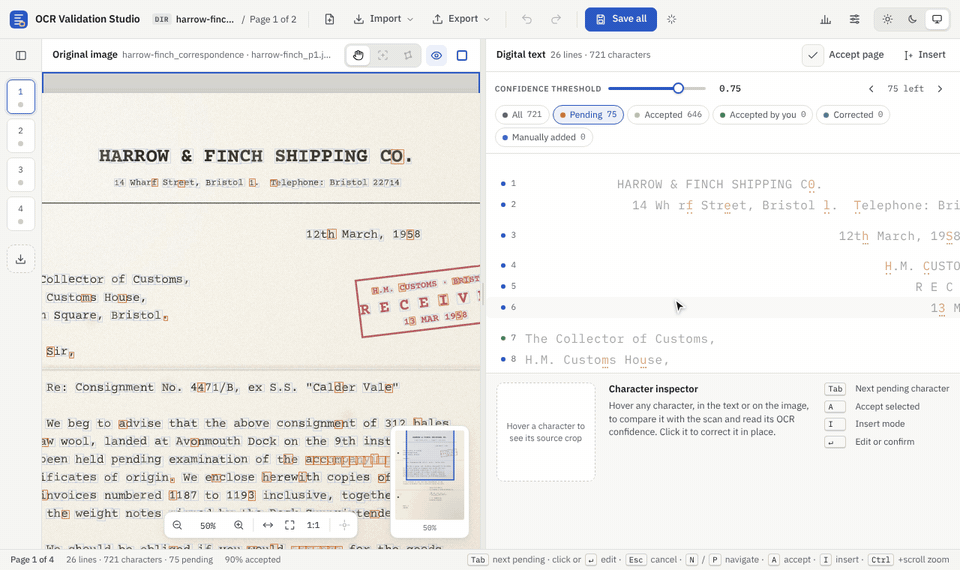
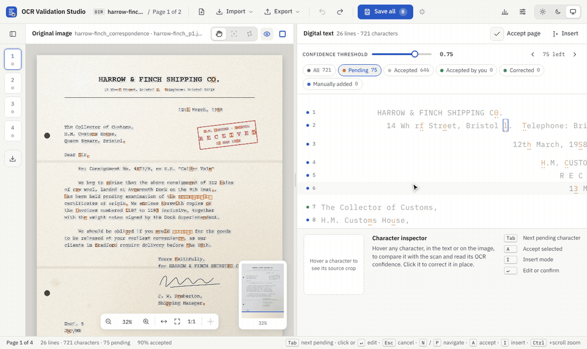
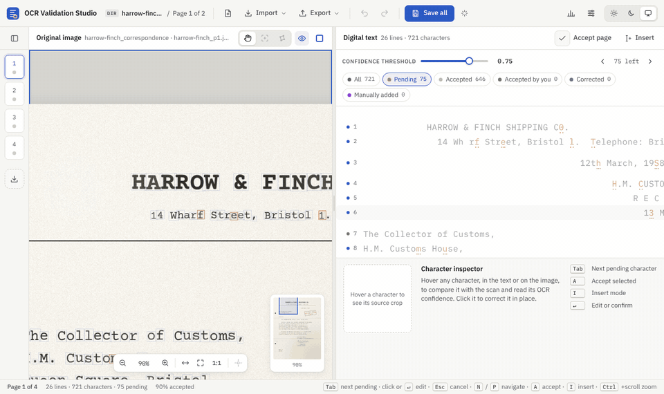
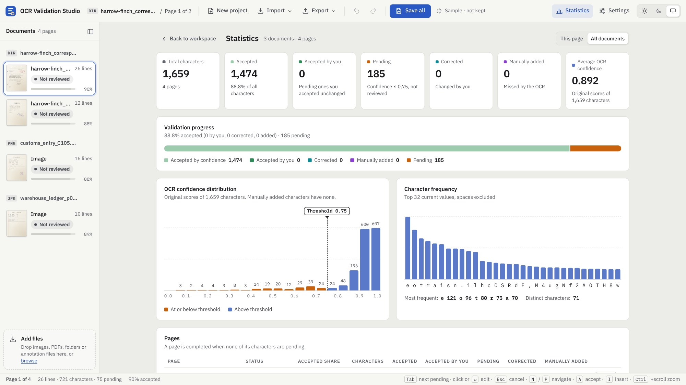
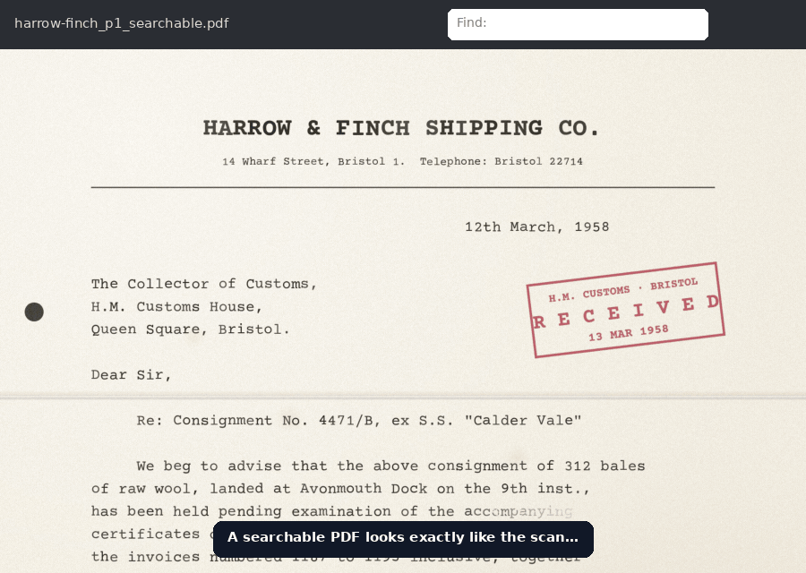
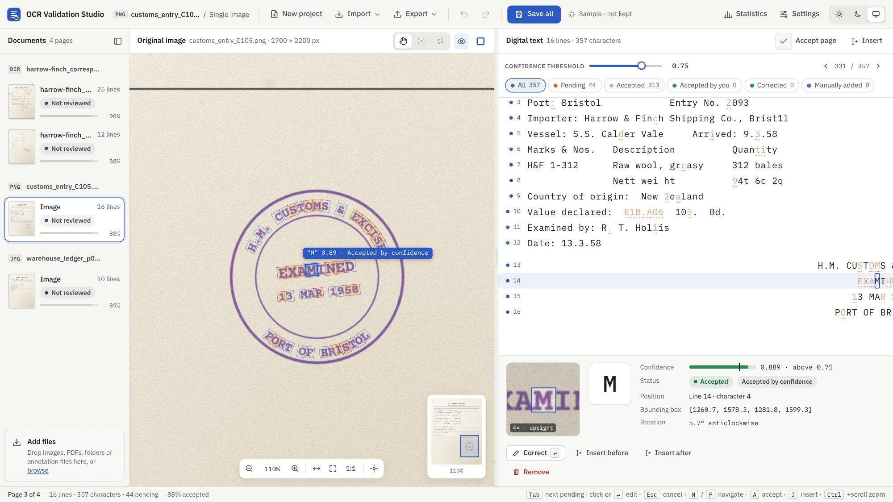

<!-- Layout rule: every image and table sits inside <div align="center"> … </div>,
     with a blank line after the opening tag and before the closing one so the Markdown inside still renders. -->

<div align="center">


# OCR Validation Studio

**Check OCR text against the original scan, character by character, right in your browser.**

[**▶ Live demo**](https://AmirniesoH.github.io/ocr-validation-studio/) · [**User Guide**](USER_GUIDE.md) · [Examples](examples/) · [Developer guide](docs/DEVELOPER_GUIDE.md)

[](LICENSE)



</div>

## What it is

OCR engines make mistakes: a `0` for an `O`, an `l` for a `1`, a letter missed on a faded line. OCR Validation Studio is a review tool for finding and fixing those mistakes quickly.

It shows the **scanned page on the left** and the **recognised text on the right**, linked character by character. Every character the OCR was unsure about is highlighted. You jump from one to the next, compare it with the scan, and correct it, accept it, add what the OCR missed, or remove what it detected by mistake. When you are done, you export clean, validated text and data.

It was built for validating **whole books**: hundreds of pages and hundreds of thousands of characters stay fast.

## Why use it

- **Nothing to install, nothing uploaded.** It is one web page. Your scans and text are read inside your browser and never leave your computer.
- **You only look at what needs looking at.** A confidence threshold separates the characters the OCR was sure about from the ones it was not. `Tab` takes you through the uncertain ones.
- **The scan is always beside the text.** Hover or select a character on either side and the other side shows it too, with a magnified crop of the original.
- **Your work is safe.** The original OCR values are never overwritten; your corrections are stored next to them. Work is saved in the browser automatically and restored when you come back.
- **It reads what your OCR tool writes.** JSON, Parquet or SQLite, flat or nested, with field names detected automatically.
- **It writes what you need next.** Plain text, Word, PDF, searchable PDF, JSON, CSV, Parquet, SQLite, ALTO XML and hOCR.

## See it in action

### Both sides stay in sync

Point at a character in the text and it lights up on the scan. Point at the scan and it lights up in the text. Click either one to edit it.

<div align="center">



</div>

### Add what the OCR missed

<div align="center">



</div>

### Track your progress

<div align="center">



</div>

<details>
<summary><b>More features</b></summary>

#### Searchable PDFs

Export the original scan with the validated text as an invisible layer on top. It looks like the scan, but you can search it, select it and copy from it.

<div align="center">



</div>

#### Rotated text

Stamps and seals are read along their own direction and shown straightened in the text:

<div align="center">



</div>

</details>

## Try it

### Online

Open the **[live demo](https://AmirniesoH.github.io/ocr-validation-studio/)** and click **Try with sample documents**. Four practice pages load with realistic OCR mistakes, nothing is uploaded, and nothing you do there is kept.

### On your own computer

1. [Download this repository](../../archive/refs/heads/main.zip) and unzip it (or `git clone` it).
2. Open **`index.html`** in Chrome, Edge, Firefox or Safari.

That is all: there is no installer, no server and no build step. It also works without an internet connection.

> **Optional:** dragging a whole *folder* into the window needs the page to be served rather than opened as a file. Run `python3 -m http.server` in the project folder and open <http://localhost:8000>. Everything else, including **Import → Import folder**, works either way.

### With your own files

You need the scanned pages (images or a PDF) and the OCR result as an annotation file with one record per character. The smallest valid annotation file looks like this:

```json
[
  { "text": "H", "conf": 0.98, "bbox": [120, 80, 150, 120] },
  { "text": "i", "conf": 0.42, "bbox": [154, 80, 166, 120] }
]
```

Name it like the image (`letter.png` + `letter.json`) and import both. The [examples folder](examples/) has ready-to-import files for every supported layout, including a book with one file per page.

## Documentation

<div align="center">

| | |
|---|---|
| 📘 **[User Guide](USER_GUIDE.md)** | Everything about using the app: importing, reviewing, every setting, every export format, with pictures. **Start here.** |
| 📂 **[Examples](examples/)** | Sample input files you can import, and what each export looks like. |
| 🛠 **[Developer guide](docs/DEVELOPER_GUIDE.md)** | How the code is organised, the file formats in detail, and how to extend the app. |

</div>

## At a glance

<div align="center">

| | |
|---|---|
| **Scans** | PNG, JPEG, WebP, GIF, BMP, AVIF images · multi-page PDFs · whole folders |
| **Annotations** | JSON · Parquet · SQLite, one record per character (value, box, confidence) |
| **Text exports** | Plain text · Word (DOCX) · Text PDF · Searchable PDF |
| **Data exports** | Validated JSON · Parquet · SQLite · CSV · ALTO XML v4 · hOCR |
| **Rotated text** | Stamps, seals and skewed lines, from four-corner polygons |
| **Languages** | Any script the OCR produced, including right-to-left text |
| **Scale** | Tested with a 300-page book of 800,000 characters |
| **Privacy** | Runs entirely in the browser; no server, no account, no tracking |
| **Browsers** | Chrome, Edge, Firefox, Safari (current versions) |
| **License** | Apache 2.0 |

</div>

## Built with

Plain HTML, CSS and JavaScript, with no framework and no build step. A few bundled libraries do the heavy lifting, each under its own license in [`vendor/`](vendor/): [PDF.js](https://mozilla.github.io/pdf.js/) (reading PDFs), [jsPDF](https://github.com/parallax/jsPDF) (writing PDFs), [JSZip](https://stuk.github.io/jszip/), [hyparquet](https://github.com/hyparam/hyparquet) (Parquet) and [sql.js](https://sql.js.org/) (SQLite).

## License

OCR Validation Studio is released under the [Apache License 2.0](LICENSE). You may use, modify and distribute it, including commercially, provided you keep the license and copyright notices and state any changes you make to the files.

The bundled libraries in [`vendor/`](vendor/) keep their own licenses: PDF.js (Apache 2.0), jsPDF, JSZip, hyparquet and sql.js (MIT). The fonts are under the SIL Open Font License and the Bitstream Vera / DejaVu license. Each license file is in the `vendor/` folder.
