# OCR Validation Studio: User Guide

Everything you need to check and correct OCR text with OCR Validation Studio, from opening your first page to exporting a finished book.

New here? Read [Quick start](#1-quick-start) (two minutes), then come back to the rest when you need it.

## Table of contents

1. [Quick start](#1-quick-start)
2. [How it works](#2-how-it-works)
3. [The workspace](#3-the-workspace)
4. [Preparing your files](#4-preparing-your-files)
   - [Scans: images and PDFs](#41-scans-images-and-pdfs)
   - [Annotation files](#42-annotation-files)
   - [Field names the app recognises](#43-field-names-the-app-recognises)
   - [Bounding boxes](#44-bounding-boxes)
   - [Confidence](#45-confidence)
   - [Lines, order and spaces](#46-lines-order-and-spaces)
   - [Rotated text](#47-rotated-text)
   - [Several pages](#48-several-pages)
   - [Parquet and SQLite](#49-parquet-and-sqlite)
   - [Example files](#410-example-files)
5. [Importing](#5-importing)
   - [Ways to add files](#51-ways-to-add-files)
   - [How files are paired](#52-how-files-are-paired)
   - [The import dialog](#53-the-import-dialog)
   - [Fixing the field mapping](#54-fixing-the-field-mapping)
6. [Reviewing a page](#6-reviewing-a-page)
   - [The confidence threshold](#61-the-confidence-threshold)
   - [Character groups and colours](#62-character-groups-and-colours)
   - [The fast way: Tab, type, Enter](#63-the-fast-way-tab-type-enter)
   - [Editing a character](#64-editing-a-character)
   - [Accepting characters, lines and pages](#65-accepting-characters-lines-and-pages)
   - [Adding a missing character](#66-adding-a-missing-character) · [drawing a polygon](#drawing-a-polygon-for-tilted-characters)
   - [Removing, restoring and undoing](#67-removing-restoring-and-undoing)
   - [Filters](#68-filters)
   - [The character inspector](#69-the-character-inspector)
7. [The image viewer](#7-the-image-viewer)
8. [The Documents panel](#8-the-documents-panel)
9. [Statistics](#9-statistics)
10. [Settings](#10-settings)
11. [Saving your work](#11-saving-your-work)
12. [Exporting](#12-exporting)
    - [Scope and options](#121-scope-and-options)
    - [Text formats](#122-text-formats)
    - [What is a searchable PDF?](#123-what-is-a-searchable-pdf)
    - [Data formats](#124-data-formats)
    - [Which format should I use?](#125-which-format-should-i-use)
13. [Working with whole books](#13-working-with-whole-books)
14. [Keyboard shortcuts](#14-keyboard-shortcuts)
15. [Browser support and privacy](#15-browser-support-and-privacy)
16. [Troubleshooting and FAQ](#16-troubleshooting-and-faq)

---

## 1. Quick start

1. Open the app (the live demo, or `index.html` on your computer).
2. Click **Try with sample documents**. Four practice pages open.
3. Press **`Tab`**. The app jumps to the first character the OCR was unsure about and opens it for editing. The same character is outlined on the scan.
4. Look at the scan. If the character is wrong, type the right one. Then:
   - **`Enter`** confirms and stays there,
   - **`Tab`** confirms a change and jumps to the next uncertain character.
5. Repeat until the page says **Completed**.
6. Open **Export** and pick a format.

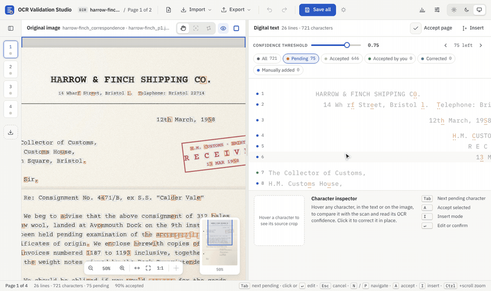

To use your own material you need two things per document: the **scan** (an image or a PDF) and an **annotation file** with the OCR result. See [Preparing your files](#4-preparing-your-files).

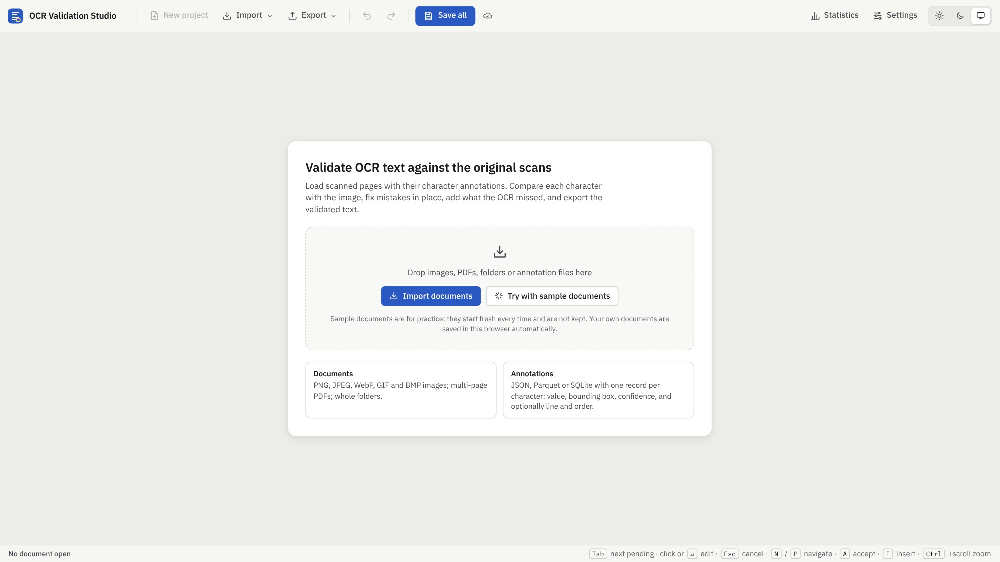

---

## 2. How it works

OCR software reads a scanned page and reports, for every character, **what** it thinks the character is, **where** it is on the page (a bounding box) and **how sure** it is (a confidence score).

OCR Validation Studio uses those three facts:

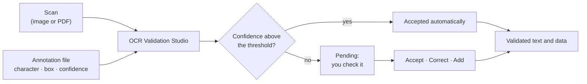

- Characters the OCR was confident about are accepted automatically.
- The rest are **pending**. They are highlighted, and you check each one against the scan.
- The original OCR value is never lost. A correction is stored next to it, so you can always see what the OCR said and go back to it.

---

## 3. The workspace

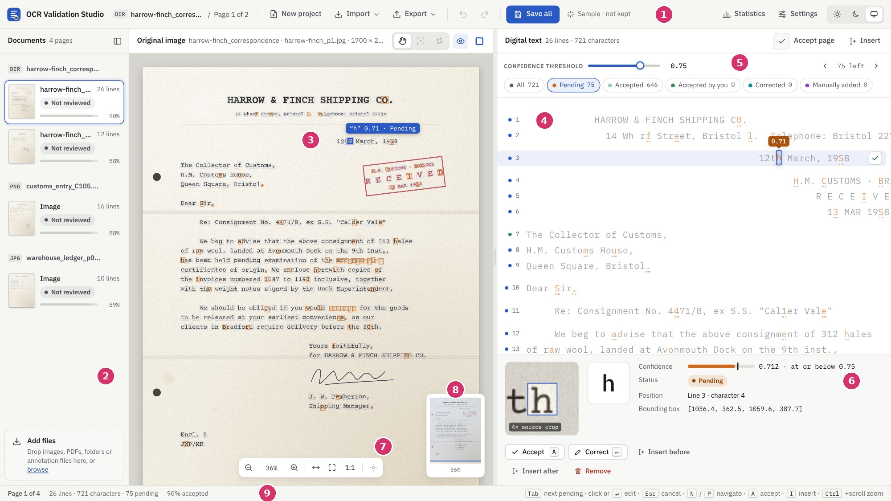

| # | Area | What it is for |
|---|---|---|
| 1 | **Toolbar** | New project, Import, Export, Undo/Redo, Save all, the auto-save status, Statistics, Settings and the theme switch. |
| 2 | **Documents panel** | Every document and page, with a thumbnail, its review status and a progress bar. Click a page to open it. |
| 3 | **Original image** | The scan, with a box around every character. |
| 4 | **Digital text** | The recognised text, laid out line by line as on the page. This is where you edit. |
| 5 | **Threshold and filters** | The confidence threshold, the review counters and filters, **Insert** and **Accept page**. |
| 6 | **Character inspector** | A magnified crop of the hovered or selected character, its confidence and status, and the actions for it. |
| 7 | **Zoom bar** | Zoom out/in, the zoom level (click it to type one), fit width, fit page, 1:1 and "centre on the selected character". |
| 8 | **Minimap** | Shows which part of the page you are looking at. |
| 9 | **Status bar** | The current page, its totals, and a reminder of the main shortcuts. |

**The two sides are linked.** Hover a character in the text and its box lights up on the scan; hover a box on the scan and the character lights up in the text. Clicking either one selects the character and opens its editor.

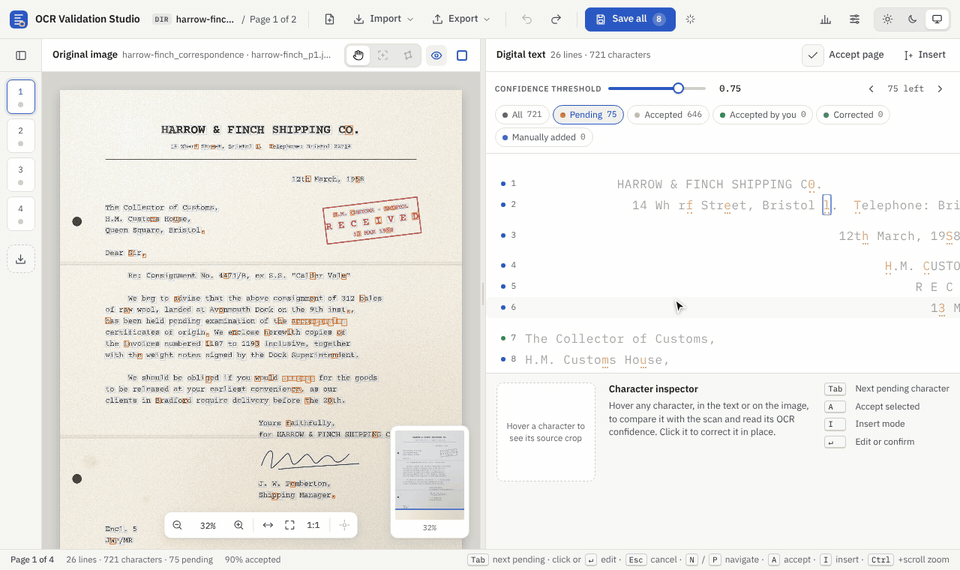

You can drag the divider between the image and the text to resize them, and collapse the Documents panel with the button in its header.

---

## 4. Preparing your files

### 4.1 Scans: images and PDFs

| Type | Notes |
|---|---|
| **Images** | PNG, JPEG, WebP, AVIF, GIF, BMP. TIFF works only in Safari; convert TIFFs to PNG or JPEG for other browsers. |
| **PDF** | Every PDF page becomes one page in the app. |
| **Folder of images** | A folder becomes **one document** with one page per image, in name order. Use this for books scanned as one image per page. |

You can open scans without annotations just to look at them, but there is nothing to validate until an annotation file is paired with them.

### 4.2 Annotation files

An annotation file holds the OCR result: **one record per character**. Three file types are supported:

| Type | Extensions | Best for |
|---|---|---|
| JSON | `.json` | Small and medium documents; easy to write and read. |
| Parquet | `.parquet`, `.pq` | Large documents and data pipelines; very compact. |
| SQLite | `.sqlite`, `.sqlite3`, `.db`, `.db3` | Whole books and collections in one file. |

Every record needs **the character** plus **a box or a confidence** (normally both):

| Field | Required? | Meaning |
|---|---|---|
| character | **yes** | The recognised character, e.g. `"A"`. |
| bounding box | recommended | Where the character is on the page. Without it, there is nothing to show on the scan. |
| confidence | recommended | How sure the OCR was. Without it, the character counts as pending. |
| line | optional | Which line the character is on. If missing, lines are worked out from the positions. |
| order in line | optional | The position within the line. If missing, characters are ordered by position. |
| page / image | for multi-page files | Which page the character belongs to. |

The **smallest valid file** is a plain list ([`minimal-flat.json`](examples/templates/minimal-flat.json)):

```json
[
  { "text": "H", "conf": 0.98, "bbox": [120, 80, 150, 120] },
  { "text": "i", "conf": 0.42, "bbox": [154, 80, 166, 120] }
]
```

A **nested** file groups characters into pages and lines ([`minimal-nested.json`](examples/templates/minimal-nested.json)):

```json
{
  "pages": [
    {
      "image": "page_001.jpg",
      "lines": [
        { "characters": [
            { "text": "H", "conf": 0.98, "bbox": [120, 80, 150, 120] },
            { "text": "i", "conf": 0.42, "bbox": [154, 80, 166, 120] }
        ] }
      ]
    }
  ]
}
```

Both shapes, and mixtures of them, are detected automatically. Nesting may go `documents → pages → blocks → lines → words → characters`; any level can be left out.

### 4.3 Field names the app recognises

You do not have to rename your fields. The app recognises the common names below (upper/lower case and `-`/`_` do not matter). If your file uses something else, you can pick the right field by hand in the [import dialog](#54-fixing-the-field-mapping).

| What | Recognised names |
|---|---|
| Character | `text`, `char`, `character`, `value`, `symbol`, `glyph`, `label`, `ch`, `unicode`, `content`, `c` |
| Confidence | `conf`, `confidence`, `score`, `prob`, `probability`, `certainty`, `ocr_conf`, `ocr_confidence`, `char_conf` |
| Bounding box | `bbox`, `box`, `bounding_box`, `rect`, `bounds`, `polygon`, `poly`, `points`, `quad`, `coords`, `geometry` |
| Box as separate columns | `x0,y0,x1,y1` · `xmin,ymin,xmax,ymax` · `left,top,right,bottom` · `x1,y1,x2,y2` · `x,y,w,h` · `x,y,width,height` · `left,top,width,height` |
| Rotated box | `polygon`, `rotated_box`, `poly`, `quad`, `points`, `vertices`, `corners` |
| Line | `line`, `line_id`, `line_index`, `line_idx`, `line_no`, `line_num`, `line_number`, `row`, `textline` |
| Order in line | `char_index`, `char_idx`, `index`, `order`, `position`, `pos`, `idx`, `seq`, `sequence`, `char_no` |
| Page number | `page`, `page_no`, `page_num`, `page_number`, `page_index`, `page_idx`, `pagenum` |
| Image name | `image`, `image_name`, `image_path`, `file`, `filename`, `file_name`, `source`, `img`, `image_id` |
| Page size | `width`/`height` on a page, or `page_width`/`page_height`, `image_width`/`image_height` |

Recognised container names: `documents`/`docs`; `pages`; `blocks`/`paragraphs`/`regions`; `lines`/`text_lines`; `words`/`tokens`; `characters`/`chars`/`symbols`/`glyphs`/`items`/`annotations`/`records`/`data`/`boxes`/`results`/`elements`.

### 4.4 Bounding boxes

Any of these forms works, and the form is detected automatically:

| Form | Example |
|---|---|
| Two corners: left, top, right, bottom | `"bbox": [120, 80, 150, 120]` |
| Corner plus size: x, y, width, height | `"box": [120, 80, 30, 40]` |
| Object with named keys | `"bbox": {"x": 120, "y": 80, "w": 30, "h": 40}` or `{"left":…, "top":…, "right":…, "bottom":…}` |
| Separate columns | `"x0": 120, "y0": 80, "x1": 150, "y1": 120` |
| Polygon (four corners) | `"polygon": [[120,80],[150,80],[150,120],[120,120]]` |

> **Two corners or corner plus size?** Four plain numbers can mean either. The app works it out from the whole file, and is nearly always right. If the boxes look far too large or stretched after importing, set **Box format** by hand in the import dialog.

**Coordinates** are measured from the top-left corner of the page and can be:

| Unit | When it is used |
|---|---|
| **Image pixels** | The default for images. |
| **Normalised 0–1** | Detected when no coordinate is larger than 1. `0.5` means the middle of the page. |
| **PDF points** | For PDFs, detected when the coordinates fit the page size in points (1 point = 1/72 inch). |
| **Pixels of a rendered PDF page** | For PDFs whose OCR ran on a rendered image. Give the page `width` and `height` in the file so the boxes can be scaled exactly. |

If your OCR ran on an image of a **different size** from the one you import (for example a downscaled copy), put that original `width` and `height` on each page in the annotation file and the boxes are scaled to fit.

### 4.5 Confidence

Confidence can be on a **0–1** scale (`0.93`) or a **0–100** scale (`93`). The scale is detected per file. Values are kept within 0–1 inside the app.

A character with **no confidence** is treated as pending, so you will be asked to check it.

### 4.6 Lines, order and spaces

- **Lines.** If your records carry a line number, it is used. If not, the app groups characters into lines from their positions.
- **Order.** If there is an index within the line, it is used; otherwise characters are ordered by position (right-to-left for right-to-left scripts).
- **Spaces.** You do **not** need records for spaces. The app adds a space wherever there is a clear gap between two boxes. This is why accurate boxes matter.
- **Paragraphs and indentation** are worked out from the gaps between lines and from where each line starts.

### 4.7 Rotated text

Stamps, seals and skewed lines need a **four-corner polygon** per character instead of an upright box, with the corners in reading order: top-left, top-right, bottom-right, bottom-left ([`minimal-rotated.json`](examples/templates/minimal-rotated.json)):

```json
[
  { "text": "P", "conf": 0.81, "polygon": [[300,200],[328,190],[342,228],[314,238]] },
  { "text": "A", "conf": 0.77, "polygon": [[331,189],[359,179],[373,217],[345,227]] }
]
```

Rotated characters get tilted outlines on the scan, are shown upright in the inspector (with their angle), and are read along their own direction, so words on a slant or around a circle come out in the right order. In the text, each stamp or seal appears as its own straightened paragraph.

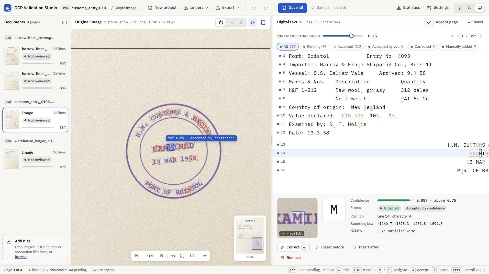

### 4.8 Several pages

There are three ways to describe a multi-page document. Pick whichever your OCR tool produces.

**A. One annotation file for the whole document, pages named by image.** Use for a folder of images.

```json
{ "pages": [
    { "image": "page_001.jpg", "lines": [ … ] },
    { "image": "page_002.jpg", "lines": [ … ] }
] }
```

**B. One annotation file for the whole document, pages numbered.** Use for PDFs. Numbering may start at 1 or at 0.

```json
{ "pages": [
    { "page": 1, "width": 1700, "height": 2200, "characters": [ … ] },
    { "page": 2, "width": 1700, "height": 2200, "characters": [ … ] }
] }
```

**C. One annotation file per page.** Use for books. Give each file the same name as its image:

```text
my-book/
├── page_001.jpg
├── page_001.json
├── page_002.jpg
├── page_002.json
└── …
```

Import the folder and the app combines the per-page files into one annotation for the book.

In a flat table (CSV-like JSON, Parquet, SQLite) the same information goes into a `page` or `image` column on every row.

### 4.9 Parquet and SQLite

**Parquet:** one row per character, with columns named as in [4.3](#43-field-names-the-app-recognises). A typical table:

| image | line | char_index | text | confidence | x0 | y0 | x1 | y1 |
|---|---|---|---|---|---|---|---|---|
| page_001.jpg | 0 | 0 | H | 0.98 | 120 | 80 | 150 | 120 |
| page_001.jpg | 0 | 1 | i | 0.42 | 154 | 80 | 166 | 120 |

**SQLite:** any database with a table (or view) shaped like the table above. The app looks at every table and picks the one that best describes characters, so other tables in the same database do no harm. For example:

```sql
CREATE TABLE ocr_characters (
  image TEXT, line INTEGER, char_index INTEGER,
  text TEXT, confidence REAL,
  x0 REAL, y0 REAL, x1 REAL, y1 REAL
);
```

If a Parquet or SQLite file holds **several documents**, add a `document` column; the rows are then split so that each document gets its own annotation.

### 4.10 Example files

The [`examples/`](examples/) folder has a ready-to-import example of every layout. Download the repository, then import any of them:

| Folder | Shows |
|---|---|
| [`01-single-image`](examples/01-single-image/) | One image + one flat JSON file. Uses `x, y, width, height` boxes, 0–100 confidence and rotated stamp text. |
| [`02-folder-with-one-json`](examples/02-folder-with-one-json/) | A folder of page images + one nested JSON for the whole document. |
| [`03-book-one-json-per-page`](examples/03-book-one-json-per-page/) | A book folder with one image and one JSON file per page. |
| [`04-pdf`](examples/04-pdf/) | A two-page PDF + a JSON with numbered pages. |
| [`05-parquet`](examples/05-parquet/) | An image + a Parquet table. |
| [`06-sqlite`](examples/06-sqlite/) | An image + a SQLite database. |
| [`07-exported-results`](examples/07-exported-results/) | What each of the ten export formats looks like. |
| [`templates`](examples/templates/) | Three tiny JSON files to copy and adapt. |

See [`examples/README.md`](examples/README.md) for details on each.

---

## 5. Importing

### 5.1 Ways to add files

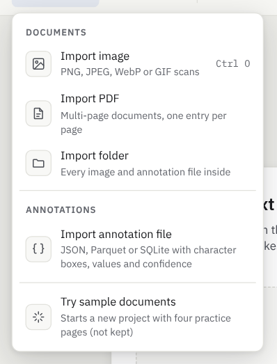

- **Import menu** in the toolbar (or `Ctrl+O`):
  - **Import image**: one or more images, each becoming its own document.
  - **Import PDF**: one or more PDFs.
  - **Import folder**: a folder of page images (plus its annotation files) as one document.
  - **Import annotation file**: a JSON, Parquet or SQLite file for documents you are adding or that are already open.
  - **Try sample documents**: the practice pages.
- **Drag and drop** onto a drop area: the start screen, the **Add files** area at the bottom of the Documents panel, or the import dialog. Dropping elsewhere in the window does nothing, so a stray drop cannot interrupt your work.

You can add more files at any time; they join the open project.

> **Dropping a folder.** When the app is opened straight from disk (`index.html`), browsers do not let a page read a dropped folder. The app tells you so; use **Import → Import folder** instead, which always works.

### 5.2 How files are paired

Each annotation file is matched to a document in this order:

1. **By name.** `letter.json` pairs with `letter.png`; `book.json` pairs with a folder called `book` or with `book.pdf`. Endings such as `.validated` are ignored, so `letter.validated.json` (a file this app exported) also pairs with `letter.png`.
2. **By the image names inside the file.** If the file's pages name `page_001.jpg`, `page_002.jpg`, …, it pairs with the document that contains those images.
3. **Per-page files.** Annotation files named after individual pages of one document are combined and paired with it.
4. **The only candidate.** One document and one annotation file imported together are paired whatever their names.

Inside a document, each group of characters goes to a page by its **image name**, otherwise by its **page number**. For PDFs the page number wins.

Document names are kept unique: a second `scan.png` becomes `scan (2).png`.

### 5.3 The import dialog

Every import goes through one dialog that shows what was found and how it was paired before anything is added.

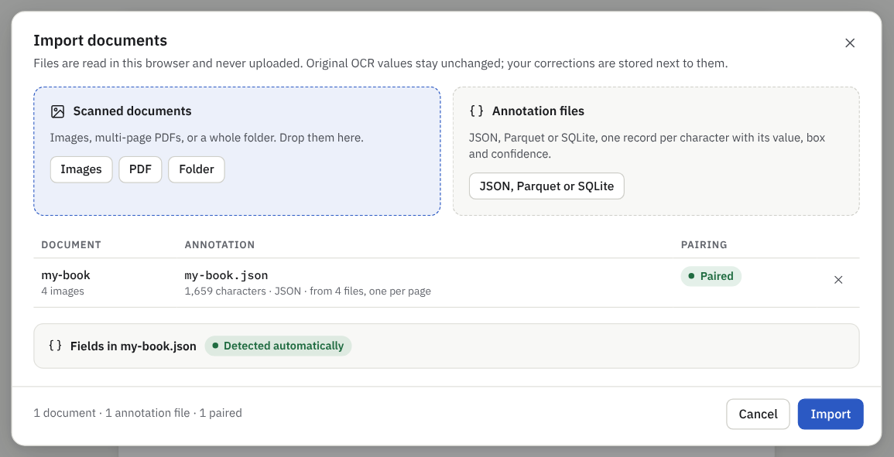

The table has one row per document:

| Pairing | Meaning |
|---|---|
| **Paired** | Every page has characters. |
| **3 of 10 pages** | Only some pages were matched. Check the image names or page numbers in your file. |
| **No pages matched** | The file was paired with the document but none of its pages fit. |
| **Image only** | No annotation for this document. You can import it and add the annotation later. |
| **Not paired** | An annotation file with no document. Choose its document in the row's drop-down. |
| *Replaces the current annotation* | The document is already open and annotated; importing replaces its characters. |
| *N characters without a page* | Some records pointed to a page the document does not have. |

You can change which document an annotation belongs to, remove a row, and drop more files into the dialog. Nothing changes in your project until you confirm.

### 5.4 Fixing the field mapping

Under each annotation file the dialog shows which fields it will read. When everything was recognised it is collapsed with a **Detected automatically** note. Open it to check or change:

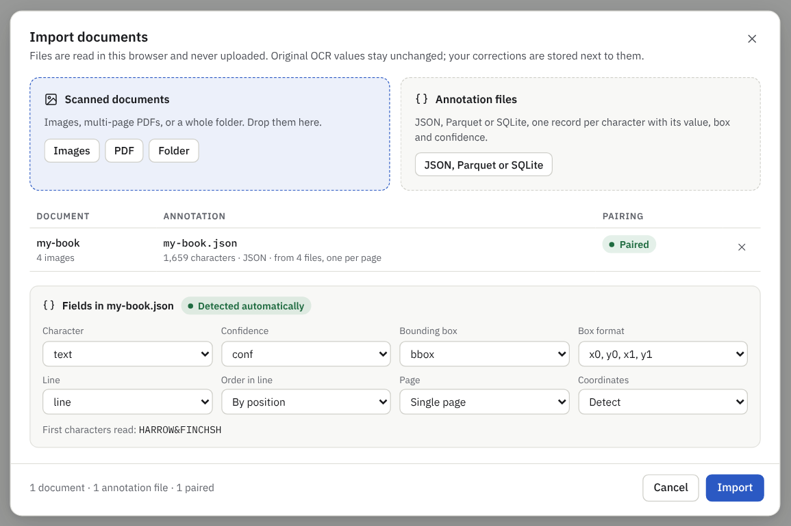

| Setting | Choices |
|---|---|
| **Character** | The field holding the character. |
| **Confidence** | The field holding the confidence, or none. |
| **Bounding box** | The field holding the box (or the detected separate columns). |
| **Box format** | Detect · `x0, y0, x1, y1` · `x, y, width, height` · Polygon / points · Object with named keys |
| **Line** | A field, or **Infer from positions**. |
| **Order in line** | A field, or **By position**. |
| **Page** | A field, or **Single page**. |
| **Coordinates** | Detect · Image pixels · Normalized 0–1 · PDF points |

The pairing and character counts update as you change these, so you can see straight away whether a change helped.

---

## 6. Reviewing a page

### 6.1 The confidence threshold

The **Confidence threshold** slider above the text decides which characters need your attention:

- confidence **above** the threshold → accepted automatically;
- confidence **at or below** the threshold (or missing) → **pending**.

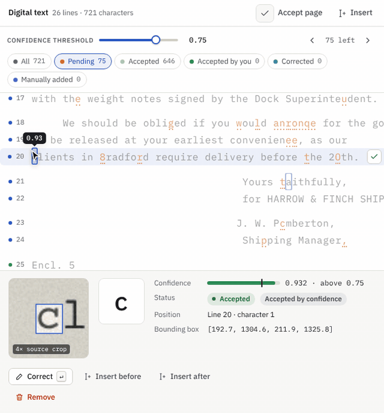

Raise it to check more characters (safer, slower); lower it to check fewer. A good starting point is where the pending characters are mostly real mistakes; the [confidence chart in Statistics](#9-statistics) helps you find it. You can change the threshold at any time: characters you have already reviewed stay reviewed.

### 6.2 Character groups and colours

Every character is in exactly one group:

| Group | Meaning | In the text |
|---|---|---|
| **Pending** | Low or missing confidence, not reviewed yet. | orange highlight |
| **Accepted by confidence** | Confidence above the threshold. | plain text |
| **Accepted by you** | Was pending; you checked it and it was right. | green |
| **Corrected** | You changed its value. The OCR's value is kept. | teal |
| **Manually added** | You inserted it; the OCR missed it. | purple |

**Accepted** means every group except Pending. A page is **Completed** when nothing on it is pending.

A character that should not be there at all (a speck read as a full stop, for example) can be [removed](#67-removing-restoring-and-undoing); it then belongs to no group and is no longer counted.

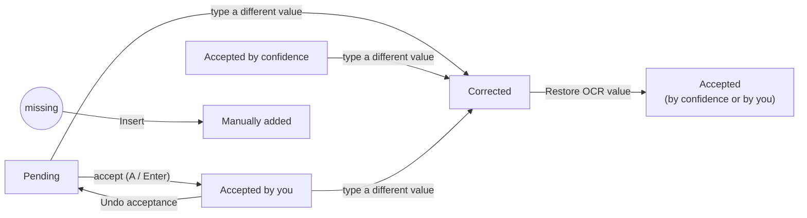

### 6.3 The fast way: Tab, type, Enter

For most pages you never need the mouse:

1. **`Tab`** jumps to the next pending character and opens its editor. The scan scrolls to it and the inspector shows it enlarged.
2. Compare it with the scan.
   - **Right?** Press **`Enter`** (or `A` when the editor is closed) to accept it.
   - **Wrong?** Type the correct character, then press **`Tab`** to save and move on, or `Enter` to save and stay.
3. Repeat. **`Shift+Tab`** goes back.

`Tab` stays on the current page. When nothing is pending any more, a note says **Every character on this page is accepted**; press `PageDown` for the next page.

### 6.4 Editing a character

Click a character, in the text or on the scan, to open its editor.

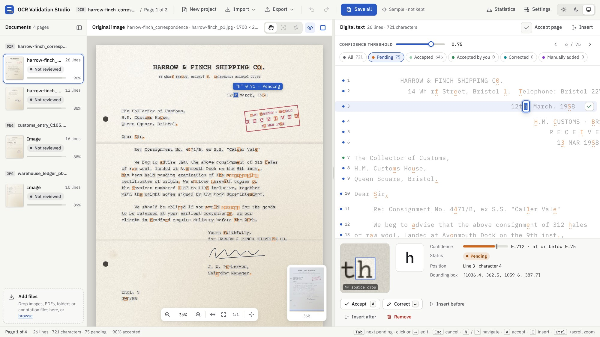

| Key | What happens |
|---|---|
| **`Enter`** | Confirm. A changed value becomes **Corrected**. An unchanged *pending* character becomes **Accepted by you**. An unchanged accepted character is left as it is. |
| **`Tab`** | Save a changed value and go to the next pending character. An unchanged character is **skipped, not accepted**. |
| **`Esc`** or **clicking anywhere else** | Cancel. The character stays exactly as it was; a pending one stays pending. |

> Only `Enter` accepts. Clicking away never accepts anything by accident.

Typing the original OCR value back into a corrected character ends the correction.

### 6.5 Accepting characters, lines and pages

Accepting means "I checked it; the OCR was right". Only pending characters can be accepted, and accepting never changes a character.

- **One character:** select it and press **`A`** (accepts and moves to the next), or `Enter` in its editor, or **Accept** in the inspector.
- **A whole line:** hover the line and click its **✓** (Accept line) button.
- **A whole page:** **Accept page** above the text.

Use line and page acceptance after you have read the line or page against the scan. All three can be undone with `Ctrl+Z`.

### 6.6 Adding a missing character

When the OCR skipped a character:

1. Click **Insert** above the text (or press **`I`**). Insertion points appear between characters and a **+** at the end of each line.
2. Click where the character belongs and type it. Press `Enter`.
3. Draw its outline on the scan. A bar at the top of the image asks for it and lets you choose the shape, **Box** or **Polygon**:
   - **Box**, for upright characters: drag a rectangle around the character.
   - **Polygon**, for tilted or rotated characters: click the character's four corners. See [below](#drawing-a-polygon-for-tilted-characters).

   **Skip** (or `Esc`) leaves the character without an outline; you can draw it later.

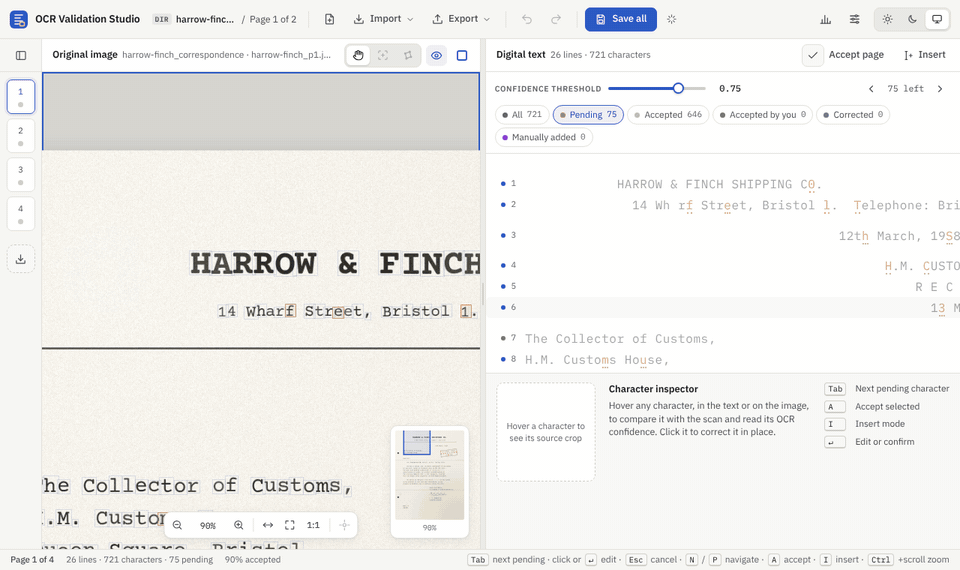

You can also use **Insert before** and **Insert after** in the inspector for the selected character.

Added characters are shown in purple. Drawing an outline is optional but recommended: it places the character correctly in searchable PDFs and layout exports, and lets the inspector show its crop. To draw it later or to replace one you are not happy with, select the character and choose **Draw box** or **Draw polygon** in the inspector (or the two drawing tools above the image).

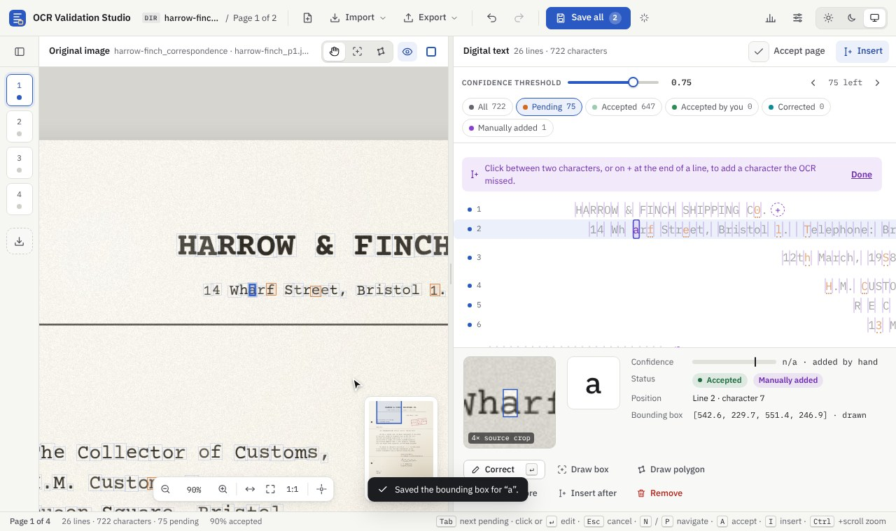

#### Drawing a polygon for tilted characters

An upright rectangle around a tilted character (on a stamp, a seal or a skewed line) is too large and overlaps its neighbours. A polygon follows the character's own slant.

1. Choose **Polygon** in the bar at the top of the image.
2. Click the **four corners** of the character, **in any order**. A dashed outline follows the pointer and the bar counts the corners.
3. The fourth click saves the polygon.

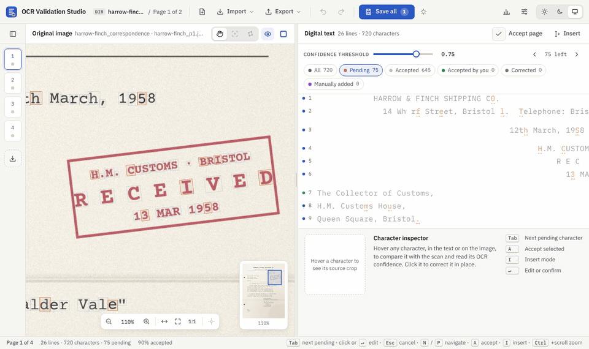

- **Reading direction is worked out for you.** On a line with other rotated characters, the new one is given the same direction as its neighbours; elsewhere, the direction closest to upright. The inspector then shows its **Rotation** and an upright crop.
- **Dragging still moves the page** while you place corners, and you can zoom, so you can place them precisely.
- **Start over** clears the corners placed so far; **Skip** or `Esc` cancels.
- Four points in a straight line are refused, with a message. Four level corners are simply saved as an ordinary box.
- The app **remembers the shape you used last**, so when you add several characters to a stamp you choose Polygon only once.
- Drawing a box for a character that has a polygon replaces the polygon, and the other way round. `Ctrl+Z` undoes either.

In exports, a polygon is written like the OCR's own rotated characters: `polygon` in the validated JSON and `rotated_box` in CSV, Parquet and SQLite, with the upright bounds in `bbox` / `x0…y1`.

### 6.7 Removing, restoring and undoing

**Removing a character.** Sometimes the OCR "reads" something that is not text: a speck, a stain, part of a ruled line, the edge of a stamp. Remove it:

1. Click the character, in the text or on the scan.
2. Click **Remove** in the inspector. One click is enough, also while the character is open for editing.

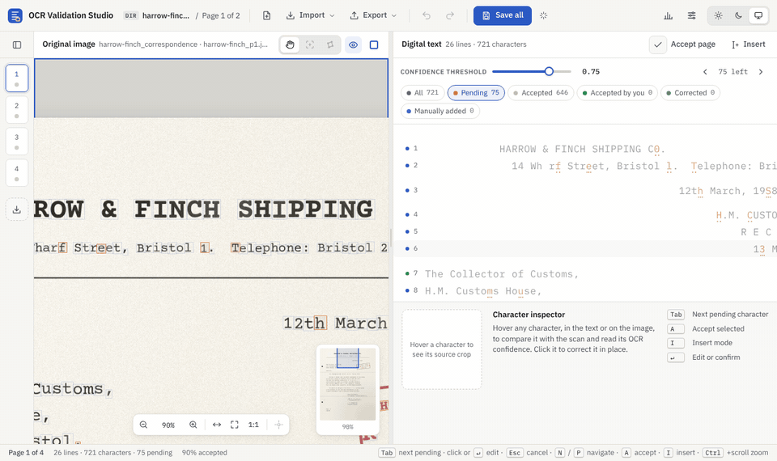

Removing takes the character out of the page completely:

- it disappears from the **text**, and its **box disappears from the scan**;
- **nothing takes its place**: the characters before and after it close up, with no space left behind. Remove the `a` from `Wharf` and you get `Whrf`, not `Wh rf`. (A character that stood on its own between two words leaves the normal gap between those words, and no space is left at the start or end of a line.)
- the **rest of the line is renumbered**: every character after it moves up one position, in the inspector's *Position*, in its word, and in the `index` / `char_index` of every export;
- if it was the **only character on its line**, the line goes too and the lines below are renumbered;
- every **count follows**: the page totals, the filters, the page's status and progress in the Documents panel, and Statistics;
- it is left out of **every export** and of the files written by **Save all**, so it stays removed when you import a validated file again.

Any character can be removed: one the OCR detected, one you corrected, or one you added. **`Ctrl+Z` brings it back** exactly as it was, with its box, value and review state.

> Remove a character only when there is nothing there. If the OCR found a real character but read it wrongly, correct it instead, so its position and the OCR's original value are kept.

| Action | Where | Effect |
|---|---|---|
| **Remove** | Inspector | Removes the selected character and its box, as described above. |
| **Restore OCR value** | Inspector | Puts a corrected character back to what the OCR detected. |
| **Undo acceptance** | Inspector | Turns an "Accepted by you" character back into Pending. |
| **Undo / Redo** | Toolbar, `Ctrl+Z` / `Ctrl+Shift+Z` (or `Ctrl+Y`) | Steps back and forward through every change, including line and page acceptance. |

### 6.8 Filters

The counters above the text are also filters: **All**, **Pending**, **Accepted**, **Accepted by you**, **Corrected**, **Manually added**. Each shows how many characters it holds on this page.

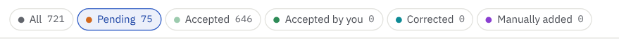

Choosing a filter dims everything else, so the matching characters stand out in context:

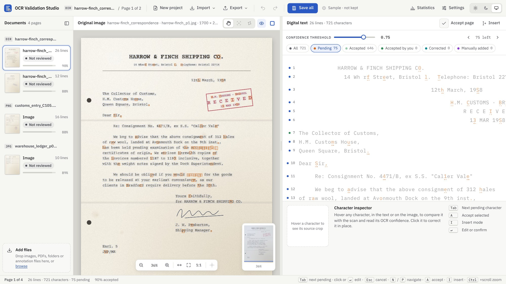

**`N`** and **`P`** (or the arrows next to the filters) step to the next and previous character *in the active filter*. For example, choose **Corrected** and press `N` repeatedly to review every correction you made.

### 6.9 The character inspector

The inspector under the text describes the hovered or selected character.

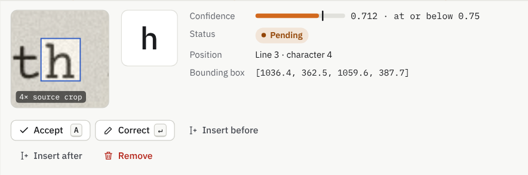

| Part | Shows |
|---|---|
| **Source crop** | The character cut from the scan and enlarged (rotated characters are turned upright). |
| **Value** | The current character; for corrected ones also what the OCR **detected**. |
| **Confidence** | The OCR's score and whether it is above the threshold. |
| **Status** | The character's group. |
| **Position** | Line and place within the line. |
| **Bounding box** | Its coordinates on the page; **Rotation** for rotated characters. |

Actions (only the ones that apply are shown): **Accept**, **Correct**, **Restore OCR value**, **Undo acceptance**, **Draw box**, **Draw polygon**, **Insert before**, **Insert after**, **Remove**.

---

## 7. The image viewer

| Control | What it does |
|---|---|
| **Pan tool** | Drag the page to move it. |
| **Draw-box tool** | Drag a rectangle to set the box of a manually added character. |
| **Draw-polygon tool** | Click four corners to outline a tilted or rotated manually added character. |
| **Show/hide boxes** (`B`) | Turns the character boxes on the scan on or off. |
| **Box style** | Quick access to the box colour, opacity and thickness. |
| **Zoom out / in** (`−` / `+`) | Step the zoom. `Ctrl` + mouse wheel zooms around the pointer. |
| **Zoom level** | Click the percentage and type a value (`150`, `150%` or `1.5x`), then `Enter`. `↑`/`↓` step by 10% (with `Shift`: 50%). `Esc` cancels. Values outside 5–800% are set to the nearest limit, with a short note. |
| **Fit width** (`0`) | The page fills the width of the pane. |
| **Fit page** | The whole page is visible. |
| **1:1** | One image pixel per screen pixel. |
| **Centre on selected character** | Brings the selected character to the middle. |
| **Minimap** | A small overview; the frame shows the visible part. |

Pending characters are tinted on the scan in the low-confidence colour, so problem areas are visible at a glance. A label above the hovered or selected box shows the character and its confidence (this can be turned off in [Settings](#10-settings)).

---

## 8. The Documents panel

The left panel lists every document and its pages. Each page card shows a thumbnail, the number of lines, a status and a progress bar.

| Status | Meaning |
|---|---|
| **No annotation** | Only the image is loaded. |
| **Not reviewed** | Annotated, nothing touched yet. |
| **In progress** | Some characters reviewed, some still pending. |
| **Completed** | Nothing is pending. |

- Click a page to open it. **`PageDown`** / **`PageUp`** go to the next and previous page.
- Hover a card to see how many characters are accepted and pending.
- The **×** on a document closes it; click it a second time to confirm.
- The **Add files** area at the bottom accepts dropped files, or click it to browse.
- Collapse the panel with the button in its header to give the page more room. Collapsed, it shows one coloured dot per page.

---

## 9. Statistics

**Statistics** in the toolbar opens the statistics view, with two tabs: **This page** and **All documents**. **Back to workspace** returns to the page.

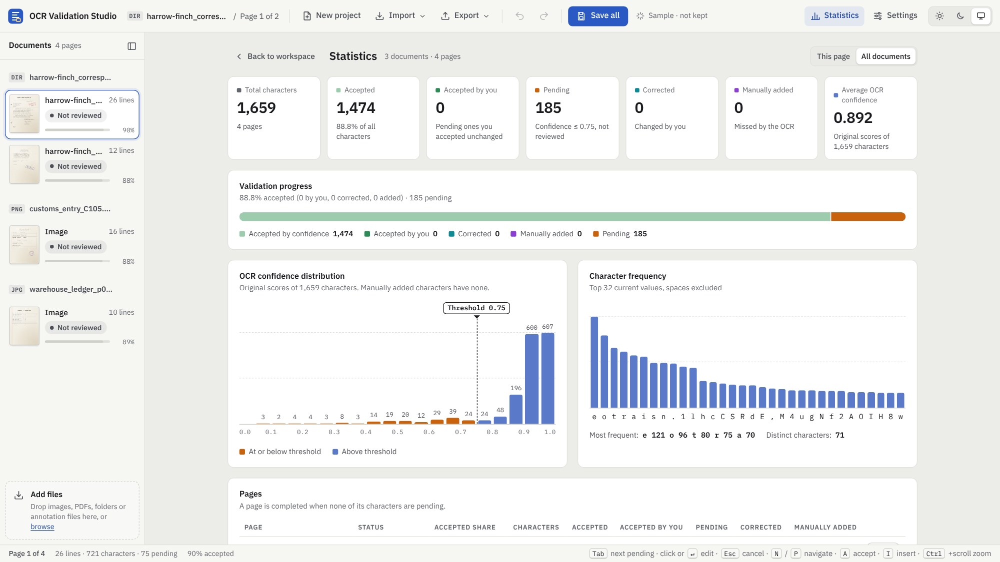

| Section | Shows |
|---|---|
| **Summary cards** | Total characters, accepted, accepted by you, pending, corrected, manually added and the average OCR confidence. |
| **Validation progress** | How many characters are in each group and the percentage accepted. |
| **OCR confidence distribution** | A histogram of the original OCR scores, with the threshold marked. Use it to choose a sensible threshold: put it just above where the low scores thin out. |
| **Character frequency** | The most common characters. |
| **Pages** (All documents) | One row per page: characters, accepted, pending, accepted by you, corrected, manually added and status. Long names are shortened with "…"; hover to read them in full. **Open** jumps to that page. |

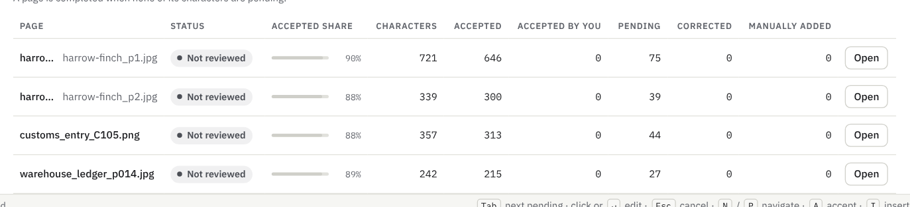

---

## 10. Settings

**Settings** in the toolbar opens the settings panel. Changes apply immediately and are remembered in this browser.

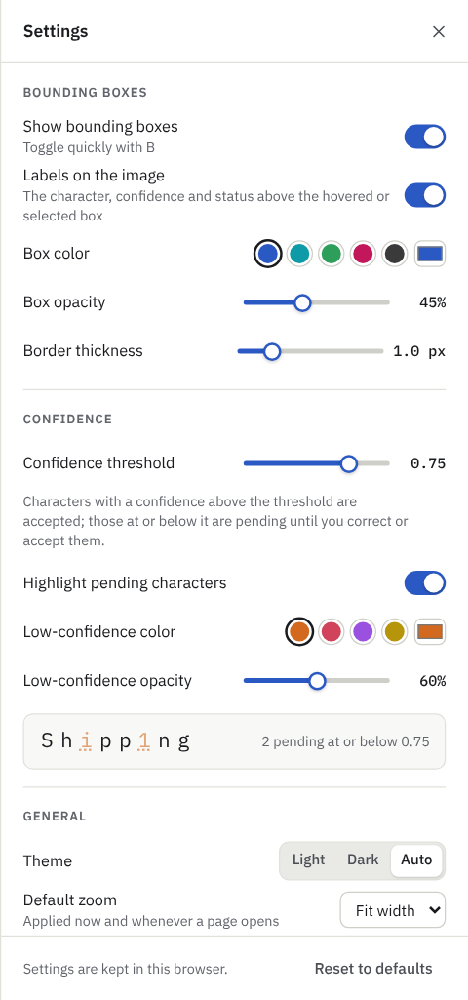

**Bounding boxes**

| Setting | Effect |
|---|---|
| **Show bounding boxes** (`B`) | Draws a box around every character on the scan. |
| **Labels on the image** | Shows the character and its confidence above the hovered or selected box on the scan. |
| **Box color**, **Box opacity**, **Border thickness** | How the boxes look. Lower the opacity on dense pages. |

**Confidence**

| Setting | Effect |
|---|---|
| **Confidence threshold** | The same value as the slider above the text. |
| **Highlight pending characters** | Tints pending characters on the scan. |
| **Low-confidence color**, **Low-confidence opacity** | The tint used for them. A preview shows the result. |

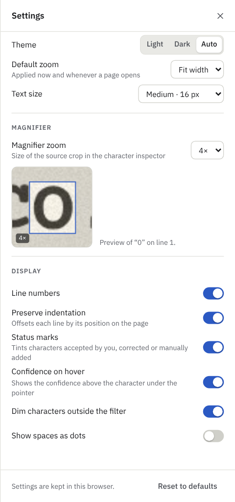

**General**

| Setting | Effect |
|---|---|
| **Theme** | Light, Dark or Auto (follows your system). Also on the toolbar. |
| **Default zoom** | The zoom used when a page opens. |
| **Text size** | The size of the digital text. |

**Magnifier**

| Setting | Effect |
|---|---|
| **Magnifier zoom** | How much the inspector enlarges the source crop. |

**Display**

| Setting | Effect |
|---|---|
| **Line numbers** | Numbers each line of the text. |
| **Preserve indentation** | Indents lines as on the page. |
| **Status marks** | Marks reviewed characters (accepted by you, corrected, added) in the text. |
| **Confidence on hover** | Shows the confidence above a character when you hover it in the text. |
| **Dim characters outside the filter** | Fades characters that do not match the active filter. |
| **Show spaces as dots** | Makes spaces visible. |

**Reset to defaults** restores every setting.

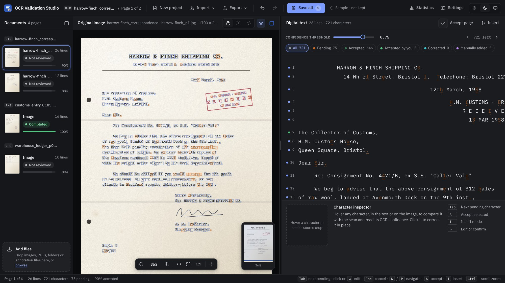

---

## 11. Saving your work

There are three layers, from automatic to explicit.

**1. Auto-save (automatic).** A moment after every change, your documents and progress are saved inside this browser. Close the tab, come back later, and the session is restored. The toolbar shows **Saving draft…**, then **Draft saved** with the time.

> Auto-save lives in *this browser on this computer*. It is not a backup: clearing the browser's site data removes it, and it does not follow you to another device. In private windows that block storage the toolbar shows **Auto-save off**.

**2. Save all (`Ctrl+S`).** Writes one **validated annotation file per document**, in the format its annotation came in (JSON, Parquet or SQLite), named like `letter.validated.json`. Your original files are never overwritten. The number on the button counts the changes since the last save.

- In Chrome and Edge you choose a folder once and the files are written there.
- In other browsers the files are downloaded (as one zip when there are several).

Validated files hold everything: current values, original OCR values, boxes, and each character's review state. **Import one together with its scan to continue where you left off**, on any computer.

**3. Export.** Produces the final text or data in the format you need. See [Exporting](#12-exporting).

**New project** closes everything and returns to the start screen. If there are unsaved changes it asks first:

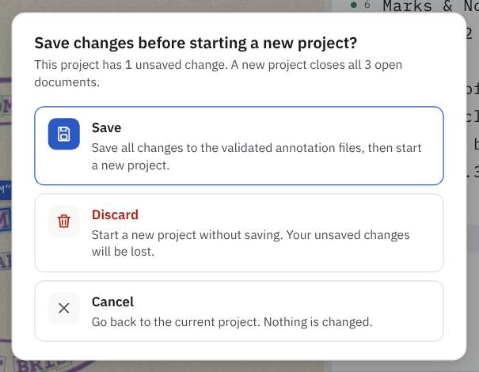

- **Save** runs Save all and then starts the new project (if the save is cancelled, the project stays open).
- **Discard** starts fresh without saving.
- **Cancel** (or `Esc`) goes back.

**Sample documents** are for practice. They are generated fresh each time and never kept; the toolbar shows **Sample · not kept**.

---

## 12. Exporting

Open **Export** in the toolbar, set the scope and options, then click a format. The file is downloaded straight away.

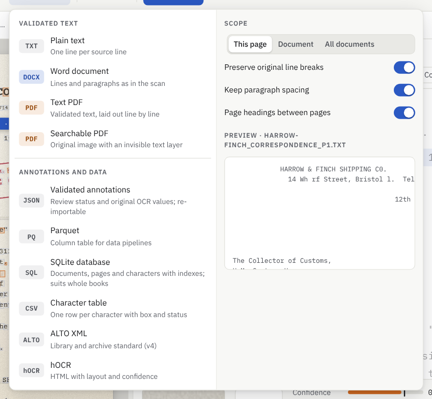

### 12.1 Scope and options

**Scope** decides how much is exported:

| Scope | Exports |
|---|---|
| **This page** | Only the page on screen. |
| **Document** | Every page of the current document. |
| **All documents** | Everything in the project. |

**Options** shape the text formats (TXT, DOCX, Text PDF). A preview in the menu shows their effect.

| Option | On | Off |
|---|---|---|
| **Preserve original line breaks** | Each line of the scan is a line of text. Best for comparing with the original, for poetry, tables and forms. | Lines of a paragraph are joined into running text. Best for reading and re-using prose. |
| **Keep paragraph spacing** | A blank line between paragraphs, as on the page. | Paragraphs follow each other without gaps. |
| **Page headings between pages** | A heading before each page when more than one page is exported. | Pages run on without a marker. |

Exports always contain the **current** values: your corrections and additions included. Pending characters are exported as the OCR read them, so finish the review first if you need fully validated output.

### 12.2 Text formats

| Format | File | What you get | Use it when |
|---|---|---|---|
| **Plain text** (TXT) | `name.txt` | The validated text, nothing else. | You want the text for search, indexing, analysis or pasting elsewhere. |
| **Word document** (DOCX) | `name.docx` | The text with its lines and paragraphs, editable in Word, LibreOffice or Google Docs. | Someone will edit or typeset the text. |
| **Text PDF** | `name.pdf` | The validated text set as a clean, new PDF. It does not contain the scan. | You want a readable, printable transcript. |
| **Searchable PDF** | `name_searchable.pdf` | The original scan with the validated text as an invisible layer on top. | You want to keep the look of the original and be able to search and copy. See below. |

### 12.3 What is a searchable PDF?

A scanned page is a picture. You cannot search a picture or copy text from it. A **searchable PDF** keeps that picture exactly as it is and puts the validated text, invisibly, exactly on top of each word.

To the eye it is the scan. To the computer it is text:

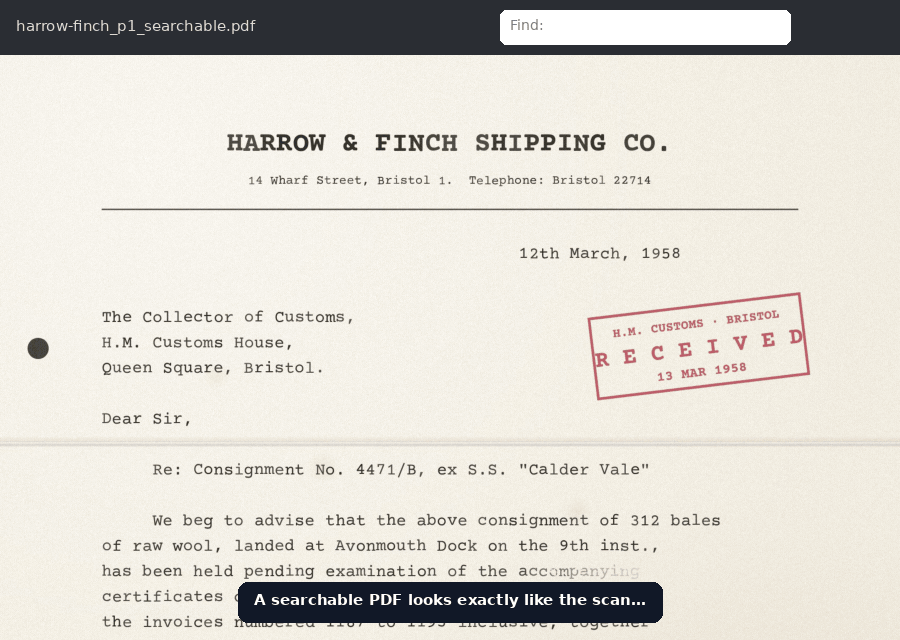

That means you can:

- **search** it with `Ctrl+F` in any PDF viewer, and see the matches highlighted on the scan;
- **select and copy** text straight from the page image;
- have it **indexed** by your computer, document systems and search engines;
- have it **read aloud** by screen readers.

Because the hidden text is the text you validated, searches find the *correct* words, not the OCR's mistakes. Rotated text (stamps, seals) is placed at its own angle.

Try it: open [`harrow-finch_correspondence_searchable.pdf`](examples/07-exported-results/harrow-finch_correspondence_searchable.pdf) and search for a word.

> The quality of a searchable PDF depends on the boxes. A manually added character needs a drawn box to sit in the right place; without one, or with a very narrow one, a word may be found in two parts.

### 12.4 Data formats

These keep the character-level detail: positions, confidence and review state.

| Format | File | What you get | Use it when |
|---|---|---|---|
| **Validated annotations** (JSON) | `name.validated.json` | Everything, nested as document → pages → lines → characters: current value, original OCR value, boxes, confidence, review state. **Can be imported again.** | You want to continue later, hand the work to a colleague, or archive the complete result. |
| **Parquet** | `name.validated.parquet` | The same information as a column table, one row per character. Very small files. **Can be imported again.** | You work with pandas, Spark, DuckDB or similar, or the document is large. |
| **SQLite database** | `name.validated.sqlite` | One database with `documents`, `pages` and `characters` tables, indexes and a ready-made `annotations` view. **Can be imported again.** | You are validating whole books, or want to query the result with SQL. |
| **Character table** (CSV) | `name.csv` | One row per character with box and status. | You want to open the data in Excel or another spreadsheet. |
| **ALTO XML** (v4) | `name.alto.xml` for one page; `name_alto.zip` with one file per page otherwise | The layout standard used by libraries and archives: text lines, words and character positions with confidence. | You deliver to a library, archive or digitisation platform that asks for ALTO. |
| **hOCR** | `name.hocr.html` | An HTML file with the text, layout and confidence embedded; the common open OCR format. | You feed tools that work with hOCR, such as PDF builders and OCR editors. |

Columns of the CSV and Parquet tables:

| Column | Meaning |
|---|---|
| `document`, `page`, `image` | Where the character is. |
| `line`, `char_index` | Its line and position in the line. |
| `text` | The current (validated) value. |
| `ocr_text` | What the OCR detected. |
| `conf` | The OCR confidence, 0–1. |
| `status` | `accepted` or `pending`. |
| `review` | The group: `accepted_by_confidence`, `accepted_by_user`, `corrected`, `manually_added` or `pending`. |
| `corrected`, `manually_added`, `verified` | The same as true/false flags. |
| `x0`, `y0`, `x1`, `y1` | The upright bounding box. |
| `rotated_box` | The four corners of a rotated character (empty otherwise). |
| `bbox_source` | Whether the box came from the OCR or was drawn by you. |
| `coordinate_unit` | The unit of the coordinates. |
| `joined` | True for a character that follows a removed one: it stays attached to the character before it, even though their boxes are now a character apart. This keeps the text the same when the file is imported again. |

With the SQLite export you can ask questions directly, for example which pages still have pending characters:

```sql
SELECT document, page, count(*) AS pending
FROM annotations
WHERE review = 'pending'
GROUP BY document, page;
```

A sample of every format is in [`examples/07-exported-results`](examples/07-exported-results/).

### 12.5 Which format should I use?

| I want to… | Use |
|---|---|
| …continue the review later or on another computer | **Save all**, or **Validated annotations (JSON)** |
| …get just the corrected text | **Plain text** |
| …edit the text in a word processor | **Word document** |
| …print or share a clean transcript | **Text PDF** |
| …keep the scan but make it searchable | **Searchable PDF** |
| …analyse the result in Excel | **Character table (CSV)** |
| …analyse it in Python, R or a data pipeline | **Parquet** |
| …store or query a whole book | **SQLite database** |
| …deliver to a library or archive | **ALTO XML** |
| …use other OCR tooling | **hOCR** |

---

## 13. Working with whole books

The app is built for books: it was tested with a 300-page book of about 800,000 characters.

**Recommended setup**

- **One folder per book**, one image per page, named so that they sort correctly (`page_001.jpg`, `page_002.jpg`, …; use leading zeros).
- **Annotations** as one JSON per page beside each image, or one Parquet or SQLite file for the whole book. For very large books prefer Parquet or SQLite: they are far smaller than JSON.
- Or a **single PDF** with one annotation file using page numbers.
- Import with **Import → Import folder**.

**What to expect** (300 pages, on an ordinary laptop)

| Step | Time |
|---|---|
| Importing the folder with 300 annotation files | about 5 seconds |
| Opening a page | a fraction of a second |
| Statistics over all pages | a fraction of a second |
| Auto-saving an edit | instant |
| Restoring the session after reopening | about 2 seconds |
| Exporting text, JSON, CSV, Parquet, ALTO, hOCR, DOCX | about a second each |
| Exporting SQLite | a few seconds |
| Exporting a searchable PDF of all 300 pages | about half a minute |

Exports of 20 pages or more show a **Preparing…** message; the searchable PDF reports the page it is working on.

**Tips**

- Set the threshold once, using the confidence chart under **Statistics → All documents**.
- Work through each page with `Tab`, then `PageDown` for the next one.
- Use **Statistics → All documents → Pages** to see which pages are left, and **Open** to jump to one.
- Press **Save all** at the end of each session and keep the validated files with the scans. Auto-save protects against a closed tab, not against a cleared browser.
- A JSON export of a whole book can be large (over 100 MB for 300 dense pages). Parquet holds the same data in about 1% of the space.

---

## 14. Keyboard shortcuts

On a Mac, use `Cmd` where `Ctrl` is shown.

**Reviewing**

| Key | Action |
|---|---|
| `Tab` / `Shift+Tab` | Next / previous **pending** character, with the editor open |
| `N` / `P` | Next / previous character in the active filter |
| `A` | Accept the selected character and move on |
| `Enter` | Open the editor for the selected character |
| `I` | Insert mode on/off |
| `Esc` | Cancel the edit, leave insert mode, close a menu or panel |

**In the editor**

| Key | Action |
|---|---|
| `Enter` | Confirm (a change is a correction; an unchanged pending character is accepted) |
| `Tab` | Save a change and go to the next pending character (unchanged: skip) |
| `Esc` or click elsewhere | Cancel without changing anything |

**View**

| Key | Action |
|---|---|
| `+` / `−` | Zoom in / out |
| `0` | Fit width |
| `Ctrl` + wheel | Zoom around the pointer |
| `B` | Show / hide bounding boxes |
| `PageDown` / `PageUp` | Next / previous page |

**Project**

| Key | Action |
|---|---|
| `Ctrl+Z` | Undo |
| `Ctrl+Shift+Z` or `Ctrl+Y` | Redo |
| `Ctrl+S` | Save all |
| `Ctrl+O` | Import |

---

## 15. Browser support and privacy

**Browsers.** Current versions of Chrome, Edge, Firefox and Safari. A desktop or laptop screen is recommended.

| Feature | Chrome / Edge | Firefox / Safari |
|---|---|---|
| Everything in this guide | ✓ | ✓ |
| Save all into a folder you choose | ✓ | downloads instead |
| Dropping a whole folder | when served from a web server | when served from a web server |
| TIFF images | ✗ | Safari only |

**Privacy.** The app has no server. Your scans and annotation files are read by your browser on your computer and are never uploaded anywhere. Auto-save uses your browser's local storage. It works offline once loaded, and when opened from `index.html` it needs no network at all.

---

## 16. Troubleshooting and FAQ

**My annotation file shows "Not paired".**
Its name does not match a document and its contents do not name the document's images. Choose the document in the import dialog's drop-down, or rename the file to match the image (`scan.png` ↔ `scan.json`).

**It says "3 of 10 pages" or "No pages matched".**
The image names or page numbers inside the file do not fit the document. Check that the `image` values equal the image file names, or that page numbers run 1, 2, 3… (or 0, 1, 2…) in the same order as the pages.

**The boxes are in the wrong place.**
- All shifted or scaled: the coordinates belong to an image of a different size. Add the page `width` and `height` used by the OCR to the annotation file, or set **Coordinates** in the import dialog.
- Stretched to the right and downwards: the box format was read as two corners instead of corner plus size (or the reverse). Set **Box format** in the import dialog.
- Upside down: the origin must be the **top-left** corner. Some PDF tools measure from the bottom-left; convert `y` to `page height − y` first.

**"No character records were found."**
Each record needs a character value plus a box or a confidence. Check the field names against [4.3](#43-field-names-the-app-recognises), or pick the fields by hand in the import dialog.

**Words are run together, or split.**
Spaces come from the gaps between boxes. Boxes that are too wide swallow the gaps; boxes that are too narrow create extra ones. Fix the boxes at the source if you can.

**Dropping a folder does nothing.**
When the app is opened from disk, browsers block reading dropped folders. Use **Import → Import folder**.

**My TIFF does not open.**
Only Safari decodes TIFF. Convert to PNG or JPEG.

**I reopened the app and my work is gone.**
Auto-save is per browser and per address. Work done at one address (for example the live demo) is not visible at another (your local copy), in another browser, or in a private window. Samples are never kept. Use **Save all** to keep files you control.

**Can I undo "Accept page"?**
Yes, `Ctrl+Z`.

**Can I delete a character the OCR invented?**
Yes. Select it and click **Remove** in the inspector. Its box is removed from the scan and all counts are updated. See [Removing a character](#67-removing-restoring-and-undoing).

**I removed a character by mistake.**
Press `Ctrl+Z`. Once the project has been closed, removed characters cannot be brought back from a validated file; import the original annotation file again if you need them.

**Can two people work on the same book?**
Not at the same moment. Split the book into parts, let each person export **Validated annotations**, and keep those files with the scans.

**How do I continue on another computer?**
Press **Save all**, copy the validated files and the scans, and import both there.

**Does the threshold change my exported text?**
No. It only decides which characters are pending. The text is always the current value of every character.

**Is there a size limit?**
No fixed limit; it depends on your computer's memory. A 300-page book works comfortably. For much larger collections, work in volumes.

---

*Want to change or extend the app? See the [Developer guide](docs/DEVELOPER_GUIDE.md).*
